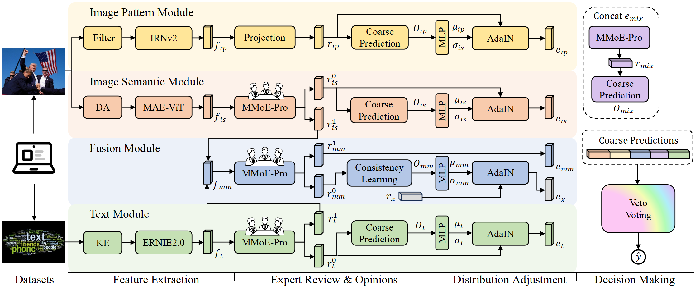

# GAMED: Knowledge Adaptive Multi-Experts Decoupling for Multimodal Fake News Detection

Research code for **GAMED**, published at **WSDM 2025**, by Lingzhi Shen, Yunfei
Long, Xiaohao Cai, Imran Razzak, Guanming Chen, Kang Liu and Shoaib Jameel.
[Paper](https://doi.org/10.1145/3701551.3703541).

GAMED models image patterns (IP), image semantics (IS) and text (T) with parallel
expert networks. MMoE-Pro refines the representations, prediction-guided AdaIN
adjusts their distributions, and Veto Voting combines branch and final-mixture
predictions. An early fusion (MM) branch provides consistency-related information.
See [MODEL_MAP.md](docs/MODEL_MAP.md) for the architecture and its implementation.

## Architecture



The code supports **Fakeddit** and **Yang**, with two independent model classes:

| Selector | Model |
|---|---|
| `gamed` | `models.gamed.GAMED`, with the active veto decision path |
| `gamed_without_veto` | `models.gamed_without_veto.GAMEDWithoutVeto`, without active veto |

## Layout

```text
run_gamed.py                  Training, validation and feature export
models/                       The two GAMED implementations
CNN_architectures/            Inception-ResNet-v2 with BayarConv
models_mae.py, util/pos_embed.py  MAE and positional initialisation
data/, utils/                 Dataset/image loading and progress reporting
resource_paths.py, config/    Resource configuration
scripts/                      Launcher and experiment commands
docs/, resources/             Method, environment, data and checkpoint metadata
third_party/licenses/         Component licence texts
checkpoint/                   Initialisation weights and default run outputs
outputs/                      Optional run output root; payloads excluded from Git
```

## Installation

Training and validation target Linux with CUDA and `fork` DataLoader workers;
Windows and `spawn`/`forkserver` workers are not supported by the current entry.
Install the dependencies in an isolated environment, using a PyTorch build
suitable for the GPU and driver:

```bash
python -m pip install -r requirements.txt
```

See [ENVIRONMENT.md](docs/ENVIRONMENT.md) for platform and dependency requirements.

## Data and checkpoints

Prepare an external resource directory containing `dataset/`, `checkpoint/` and
`ernie/`. Copy [paths.example.json](config/paths.example.json) to
`config/local.json`, then set `resource_root` to that directory. Local configuration
and resource payloads are excluded from Git. See [DATASETS.md](docs/DATASETS.md)
for data sources, required tables and image paths, and
[CHECKPOINTS.md](docs/CHECKPOINTS.md) for MAE, ERNIE and trained GAMED weights.

## Training and validation

Select a model and both datasets explicitly. Preview the Yang training command:

```bash
python scripts/run.py --dry-run run_gamed.py -network_arch gamed -train_dataset yang -test_dataset yang -val 0
```

Use the dataset-specific training and validation scripts:

```bash
bash scripts/train_yang.sh -output_file outputs
bash scripts/train_fakeddit.sh -output_file outputs
bash scripts/validate_yang.sh -checkpoint /path/to/yang_checkpoint.pkl -output_file outputs
bash scripts/validate_fakeddit.sh -checkpoint /path/to/fakeddit_checkpoint.pkl -output_file outputs
```

Replace the `/path/to/...` placeholders with existing trained GAMED state-dict
files; trained weights are not included. Both validation scripts require
`-checkpoint`; `--help` needs no checkpoint. All four scripts accept optional entry arguments;
see [scripts/README.md](scripts/README.md). Use the direct entry to choose the
`gamed_without_veto` model or different training and validation datasets.

Direct execution is also supported:

```bash
python run_gamed.py -network_arch gamed -train_dataset yang -test_dataset yang -val 0
python run_gamed.py -network_arch gamed_without_veto -train_dataset fakeddit -test_dataset fakeddit -val 0 -output_file outputs
python run_gamed.py --help
```

The entry sets the repository as the working directory. Launcher options
`--config` and `--dry-run` precede `run_gamed.py`. Validation loads only the selected validation data,
exports features/results and saves a state dict; see
[REPRODUCE.md](docs/REPRODUCE.md) for parameters, metrics and output locations.
`-output_file` controls all outputs. Each invocation creates an independent run
directory containing per-epoch checkpoints, feature files, `predictions.xlsx`
with text previews and `predictions.jsonl` with complete text and predictions.

## Citation

```bibtex
@inproceedings{shen2025gamed,
  title={{GAMED}: Knowledge adaptive multi-experts decoupling for multimodal fake news detection},
  author={Shen, Lingzhi and Long, Yunfei and Cai, Xiaohao and Razzak, Imran and Chen, Guanming and Liu, Kang and Jameel, Shoaib},
  booktitle={Proceedings of the Eighteenth ACM International Conference on Web Search and Data Mining},
  pages={586--595},
  year={2025},
  doi={10.1145/3701551.3703541}
}
```

GAMED's own code is covered by the [MIT licence](LICENSE) within the scope
described in [THIRD_PARTY.md](docs/THIRD_PARTY.md); third-party components retain
their respective licences.
